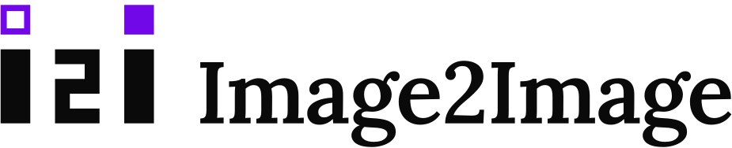
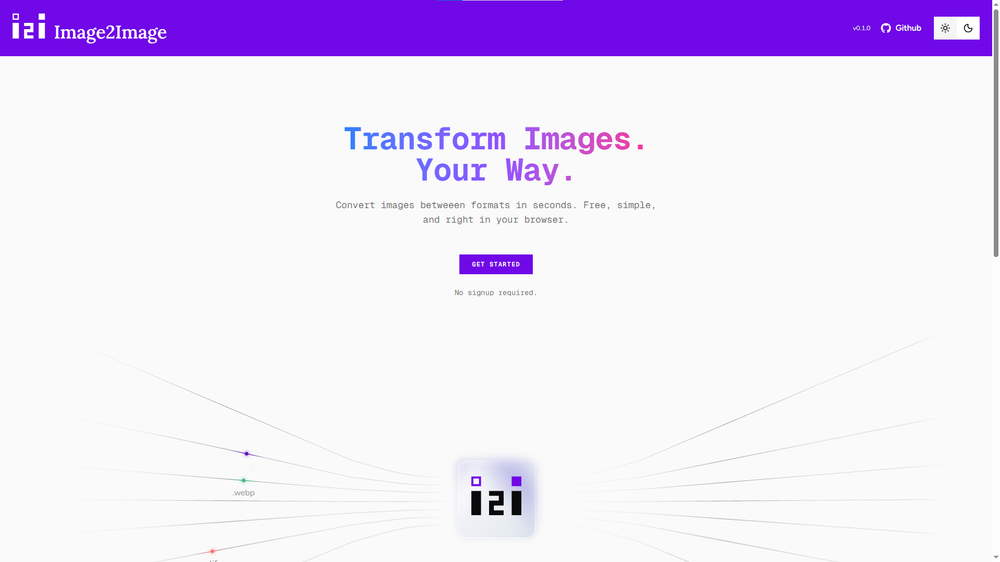

<p align="center">
  <picture>
    <source media="(prefers-color-scheme: dark)" srcset="docs/image2image-logo-light.svg">
    
  </picture>
</p>

<p align="center">
  <strong>Convert images between formats entirely in your browser.</strong><br>
  No uploads. No server. Your files never leave your device.
</p>



> [!NOTE] **A note on AI use.**
> AI assistance in this project was minimal. It was used mainly to research different browser APIs (such as Canvas, `OffscreenCanvas` and Web Workers).

---

## Highlights

- **Private by design.** A static site with no backend, accounts, or database. Open your browser's network tab while converting and you'll see the page and its code load, never your images.
- **Fast on big batches.** Conversions run in Web Workers, so the page stays responsive.
- **Many formats.** Everyday formats work out of the box, and heavier WebAssembly codecs download only when you use them.
- **Light and dark themes.**
- **More tools planned.** A background remover and other image utilities are next.

## Formats

| Format            | Input | Output |
| ----------------- | :---: | :----: |
| JPEG              |  Yes  |  Yes   |
| PNG               |  Yes  |  Yes   |
| WebP              |  Yes  |  Yes   |
| AVIF              |  Yes  |  Yes   |
| ICO               |  Yes  |  Yes   |
| TIFF              |  Yes  |  Yes   |
| GIF (first frame) |  Yes  |   -    |
| BMP               |  Yes  |   -    |
| HEIC / HEIF       |  Yes  |   -    |

Planned: JPEG XL, QOI.

## How it works

1. A file is detected by its type and extension.
2. It is decoded into raw pixels, using the browser's built-in decoder where one exists and a WebAssembly codec where it doesn't.
3. The pixels are drawn to an `OffscreenCanvas` and encoded into the target format.
4. All of this happens inside a Web Worker. The result is a `Blob` that never touches a network.

## Design notes

**One registry, no per-pair logic.** Every format is a single entry that says how to recognise it and, optionally, how to decode it (usable as input) and encode it (usable as output). Because every conversion passes through raw pixels, any format that can decode can reach any format that can encode, so the input and output lists are derived from the registry and adding a format means adding one entry.

```ts
webp: {
  id: "webp",
  label: "WebP",
  extensions: ["webp"],
  mimeTypes: ["image/webp"],
  decode: canvasDecode,
  encode: canvasEncode("image/webp"),
  supportsQuality: true,
},
```

**Codecs load on demand.** Formats that need a WebAssembly codec import it inside `decode` or `encode`, so it is only downloaded when someone uses that format.

**Work stays off the main thread.** Only plain, cloneable data crosses into the worker. Formats are passed by id and resolved from the same registry on the other side.

## Tech stack

- [Next.js](https://nextjs.org) (App Router, static export), React, TypeScript
- [Tailwind CSS](https://tailwindcss.com), [shadcn/ui](https://ui.shadcn.com), [GSAP](https://gsap.com), [Motion](https://motion.dev), [Lucide](https://lucide.dev)
- Browser APIs: Canvas / `OffscreenCanvas`, `createImageBitmap`, Web Workers
- WebAssembly codecs, loaded on demand: [jSquash](https://github.com/jamsinclair/jSquash) (AVIF), [heic-to](https://www.npmjs.com/package/heic-to) (HEIC), etc...

## Run it locally

You'll need Node.js 20 or newer.

```bash
git clone https://github.com/salman9802/image2image.git
cd image2image
pn install
pn dev
```

Then open [http://localhost:3000](http://localhost:3000).

To build the static site:

```bash
pn build
```

The output is written to `out/` and can be hosted on any static host.

## Status

Core finished. Will be adding other useful utilities later. This is a personal portfolio project, so it isn't open to contributions or pull requests.
